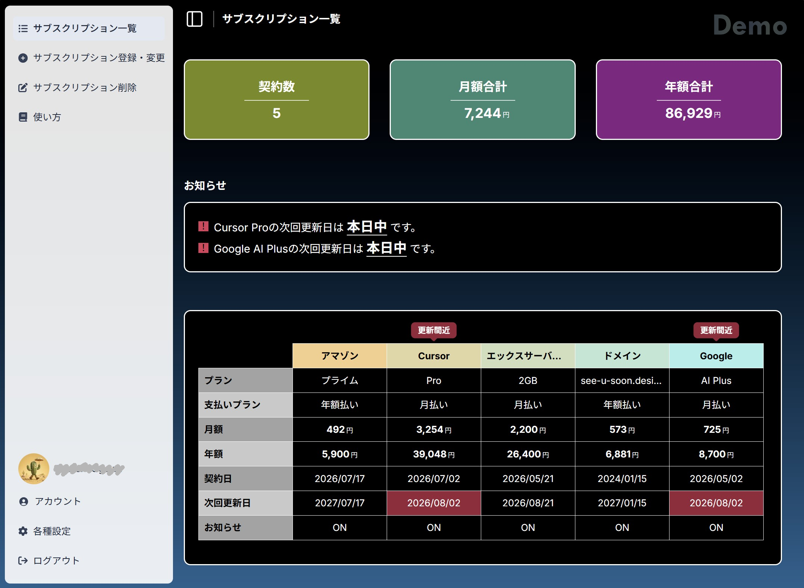
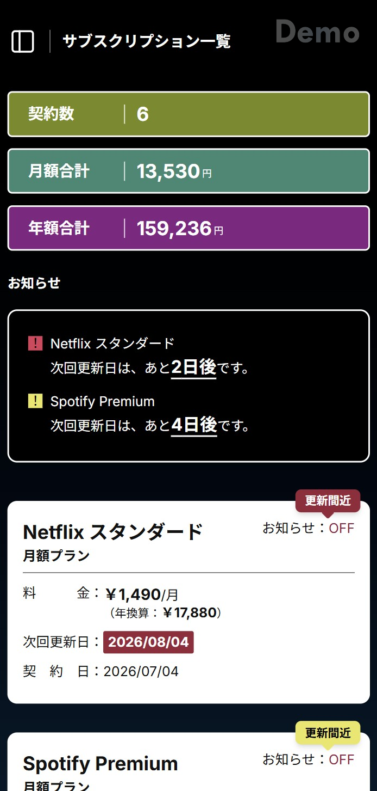

# SubscMemo（サブスクMEMO）

【デモ】
- Site：https://subscmemo.see-u-soon.design
- 登録不要（下記アカウントもしくは、デモ試用オートログインボタン）ですぐにお試しいただけます。データは毎日リセットされます。自分でアカウント登録して試すことも可能です。

<table>
  <tr>
    <td><strong>Email</strong></td>
    <td><code>demo@example.com</code></td>
  </tr>
  <tr>
    <td><strong>Password</strong></td>
    <td><code>demo1234</code></td>
  </tr>
</table>

- デモアカウントでは、二段階認証の設定・アカウント削除・メール／パスワード変更はできません。
- デスクトップ / モバイル

<table>
  <tr>
    <td width="70%" valign="top">
      
    </td>
    <td width="30%" valign="top">
      
    </td>
  </tr>
</table>

サブスクリプションの契約情報を一元管理し、更新日の前にメールで通知して解約忘れを防ぐ Web サービスです。
個人開発（企画・設計・実装・インフラ・テストまで単独）です。

## プロジェクトの概要

【課題】
- サブスクは契約を忘れたまま課金され続けやすく、契約先が増えるほど更新日も金額も把握しづらい。

【解決】
- 固定費の可視化として、月額・年額の自動換算と契約数／合計金額の集計を行う。
- 解約忘れの防止として、更新日の 3 / 5 / 7 日前にメールで通知する。

## セクションと主な機能

【サブスク管理】
- 料金・支払い周期・契約日を登録し、次回更新日を自動計算する（月末の繰り上がりに対応）。
- 月額 ⇄ 年額を自動換算し、契約数と合計金額を集計する。

【更新リマインダー】
- 日次バッチが対象を抽出し、同日に複数あればユーザーごとに 1 通へまとめて送信する。
- 送信済みを記録して重複を防ぎ、失敗時は翌日に再送する。

【認証】
- メール + パスワード、および Google / GitHub の OAuth に対応する。
- 確認メールを経ないとログインできない。同一メールでも、別プロバイダへの自動リンクは禁止する。

【二段階認証（MFA）】
- 認証アプリの TOTP に加え、バックアップコード 10 件を発行する（ハッシュ保存・1 回で失効）。
- 連続失敗時は一時ロックする。

【アカウント管理】
- プロフィール、パスワード変更、通知設定、確認ダイアログとメール通知を伴う退会に対応する。

## 技術スタック

【デザイン】
- Figma Pro（Full Seat）

【コーディング エージェント】
- Cursor Pro

【フレームワーク】
- Next.js 16（App Router）
  ※Server Components でデータ取得をサーバーに寄せるため。

【言語】
- TypeScript 6（strict）
  ※`any` を禁止し、全レイヤーで型を一貫させるため。

【UI】
- React 19 / Tailwind CSS 4 / shadcn/ui
  ※UI をソースごと取り込み、自前で調整するため。

【書体】
- Inter と Noto Sans JP

【アニメーション】
- CSS transition
  ※削除確認や行表示など、画面内の短い状態変化に使う。

【DB / ORM】
- PostgreSQL / Prisma 7
  ※制約とトランザクションで整合性を担保するため。

【認証】
- Auth.js v5（JWT）
  ※Credentials と OAuth を同一基盤で扱うため。

【検証】
- Zod / React Hook Form
  ※同一スキーマをクライアント・サーバーで共用するため。

【テスト】
- Vitest / Playwright
  ※ロジックは単体、動線は E2E と使い分けるため。

【インフラ】
- VPS + Dokploy / Docker / GitHub Actions
  ※本番相当の構成を自分で構築・自動化するため。

## 設計上の工夫

【Server Action を公開エンドポイントとして扱う】
- 直接呼び出せる前提で、すべての Action 内でセッション検証と本人確認を行う。
- ルート保護は画面遷移の入口としてのみ位置づける。

【単一の情報源を持つ】
- パス定義を `src/lib/routes.ts` に、更新日計算を `renewal-date.ts` に集約する。
- フォームのプレビューと保存値、画面遷移と保護対象がずれない構造にするため。

【副作用の設計方針を明文化】
- `useEffect` を使う条件をルール化し、それ以外は描画時の計算・イベントハンドラ・Server Component へ寄せる。

【レイアウトを画面幅で分離】
- デスクトップは表（グリッド）、モバイルはカードと DOM 自体を切り替え、横スクロールや文字切れを避ける。

【セキュリティ】
- パスワードとバックアップコードは bcrypt でハッシュ化する。
- リセット系にはレートリミットとアカウント列挙対策を適用し、Cron エンドポイントは Bearer トークンで保護する。

## 品質確認

【品質管理】
- `npm run lint`：完了
- `npm run typecheck`：完了
- Viewtest：完了
- Playwright：完了
- local 上での目視・動作確認：完了
- Deploy 後の目視・動作確認：完了

【Vitest】
- 約 36 ファイル / 170 ケース
- 日付計算、金額換算、バリデーション、Server Action などを検証する。

【Playwright】
- 約 10 スペック / 38 ケース
- 認証、ルート保護、CRUD、MFA、メール確認、デモアカウントの実動線を検証する。
- MFA のバックアップコードログインや、IMAP で届いたメールから確認リンクを取得する登録フローまで含める。

【Microsoft Edge (Latest)】
- デスクトップ：1440 × 800：完了
- タブレット：768 × 1024：完了

【Google Chrome (Latest)】
- デスクトップ：1440 × 800：完了
- タブレット：768 × 1024：完了

【Safari（iOS・Latest）】
- モバイル：390 × 844：完了

【Mozilla Firefox (Latest)】
- デスクトップ：1440 × 800：完了

## ドキュメント

【認証の設計】
- [認証の設計](docs/authentication.md) — テーブル構成、ログインパターン、ルート保護、エラー設計

【開発ガイド】
- [開発ガイド](docs/development.md) — セットアップ、環境変数、ディレクトリ構成、デプロイ

【Vitest 結果】
- [Vitest 結果](docs/vitest-results.md) — 単体テストの実施記録

【Playwright 結果】
- [Playwright 結果](docs/playwright-results.md) — E2E テストの実施記録

## 作者

【名前】
- Takashi Ogawa

【開発期間】
- 約 1.5 ヵ月

【その他】
- ポートフォリオ: https://portfolio.see-u-soon.design
- GitHub: https://github.com/onion4989
